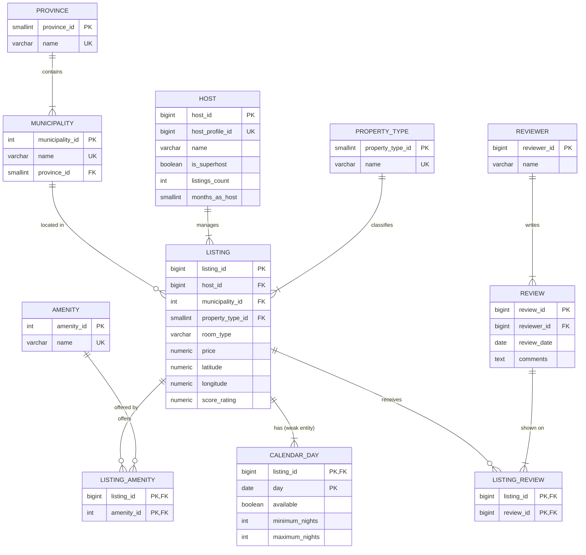

# Conceptual, logical and physical design

## 1. Entity-relationship diagram

The diagram in the course notation is in the report. The diagram below gives the same model in
Mermaid notation, which GitHub renders directly.

| Relationship | Cardinality | Justification |
|---|---|---|
| Province - Municipality | 1:N | each municipality belongs to exactly one province (0 municipalities in two provinces) |
| Municipality - Listing | 1:N (0..N) | 48 municipalities have no listing |
| Host - Listing | 1:N (1..N) | every host has at least one listing (3,094 hosts, 6,248 listings) |
| Property type - Listing | 1:N | 64 open-ended values |
| Listing - Amenity | N:M | a listing offers many amenities and an amenity appears on many listings |
| Listing - Calendar day | 1:N, weak entity | a calendar day does not exist without its listing; its key is (listing, day) |
| Listing - Review | N:M | see decision 1 |
| Reviewer - Review | 1:N | a guest writes many reviews |

## 2. Relational model

Primary keys are <u>underlined</u>; foreign keys are in *italics*.

- PROVINCE(<u>province_id</u>, name)
- MUNICIPALITY(<u>municipality_id</u>, name, *province_id*)
- HOST(<u>host_id</u>, host_profile_id, name, location, about, is_superhost, has_profile_pic, identity_verified, listings_count, months_as_host, months_as_user)
- PROPERTY_TYPE(<u>property_type_id</u>, name)
- LISTING(<u>listing_id</u>, *host_id*, *municipality_id*, *property_type_id*, name, description, latitude, longitude, room_type, accommodates, bathrooms, bathroom_shared, bedrooms, beds, price, minimum_nights, maximum_nights, has_availability, score_rating, score_accuracy, score_cleanliness, score_checkin, score_communication, score_location, score_value, license, estimated_occupancy_l365d, estimated_revenue_l365d, last_scraped)
- AMENITY(<u>amenity_id</u>, name)
- LISTING_AMENITY(<u>*listing_id*, *amenity_id*</u>)
- CALENDAR_DAY(<u>*listing_id*, day</u>, available, minimum_nights, maximum_nights)
- REVIEWER(<u>reviewer_id</u>, name)
- REVIEW(<u>review_id</u>, *reviewer_id*, review_date, comments)
- LISTING_REVIEW(<u>*listing_id*, *review_id*</u>)

All relations are in third normal form: every attribute depends on the whole key and only on the key.

## 3. Design decisions and justified exceptions

1. **Reviews are N:M with listings, not 1:N.**
   `reviews.csv` contains 8,074 repeated review ids (21,436 rows). Every copy has the same date,
   reviewer and text; only the listing changes, and it is always a listing of **the same host**.
   Airbnb shows one review on several grouped listings of a host. With `review_id` as the key of a
   1:N table the load would fail; with (listing_id, review_id) as the key the text would be stored
   13,362 extra times. REVIEW stores each review once and LISTING_REVIEW stores the link.
   Consequence: counting the reviews of an area requires `COUNT(DISTINCT review_id)` (Q03).

2. **No derivable columns are stored.** `number_of_reviews`, `first_review`, `last_review` and
   `reviews_per_month` can be computed from LISTING_REVIEW and REVIEW; profiling confirmed that they
   match for 100% of the listings. `calculated_host_listings_count*` is a `COUNT` per host, and
   `availability_30/60/90/365`, `minimum_minimum_nights` and similar come from CALENDAR_DAY.
   Storing them would create two sources of truth that could contradict each other.
   Exceptions: `host.listings_count` counts the host's listings across all of Airbnb, not only in
   Euskadi, so it cannot be derived; `estimated_occupancy_l365d` and `estimated_revenue_l365d` are
   Inside Airbnb model estimates based on data the project does not have.

3. **Discarded columns:** the 12 columns that are 100% empty (`host_since`, `host_response_rate`,
   `bathrooms`, `instant_bookable`, ...), URLs (rebuilt from the id), constant scrape metadata
   (`scrape_id`, `calendar_last_scraped`), `host_verifications` (always "None") and the
   `price_quote_*` fields (a one-off quote that duplicates the price). Also `bathrooms_text`,
   because all of its information is kept in `bathrooms` and `bathroom_shared` (R05), and `source`,
   which is empty for 86% of the listings and whose only value (`previous scrape`) is undocumented.

4. **`room_type` is a CHECK and `property_type` a table.** `room_type` has 4 fixed values defined by
   Airbnb, so a CHECK is enough. `property_type` has 64 open-ended values, so it is a reference table.

5. **Amenities in a separate table.** The CSV stores them as a JSON list inside one cell, which
   violates first normal form. Splitting them allows SQL questions such as "which listings offer X?" (Q06).

6. **Prices are in euros** even though the CSV uses a `$` sign, which is a fixed Inside Airbnb
   format. They are stored as `NUMERIC(10,2)`: exact money, without floating-point errors.

7. **Surrogate keys (IDENTITY)** for province, municipality, property_type and amenity, whose
   natural keys are long strings (kept as `UNIQUE`). Airbnb identifiers (`listing_id`, `host_id`,
   `review_id`, `reviewer_id`) stay as natural `BIGINT` keys because they reach 1.7·10^18 and do
   not fit in `INTEGER`.

8. **`minimum_nights > maximum_nights`** (2 listings and 763 calendar days) is impossible. Since it
   is unknown which value is wrong, both are set to NULL. No value is invented, and the constraint
   `CHECK (minimum_nights <= maximum_nights)` can exist.

## 4. Data types

| Data | Type | Reason |
|---|---|---|
| Airbnb ids | `BIGINT` | values of up to 19 digits |
| price, revenue | `NUMERIC(10,2)` | exact money |
| scores | `NUMERIC(3,2)` + CHECK 0-5 | e.g. 4.87 |
| latitude / longitude | `NUMERIC(8,6)` / `NUMERIC(9,6)` | 6 decimals is about 0.1 m; CHECK with the Euskadi bounding box |
| bathrooms | `NUMERIC(3,1)` | allows half bathrooms (1.5) |
| guests, beds, bedrooms | `SMALLINT` | small values (max. 29) |
| dates | `DATE` | the data has no time of day |
| t/f | `BOOLEAN` | |
| short texts | `VARCHAR(n)` with n above the maximum observed in profiling | |
| descriptions, reviews | `TEXT` | free length |
