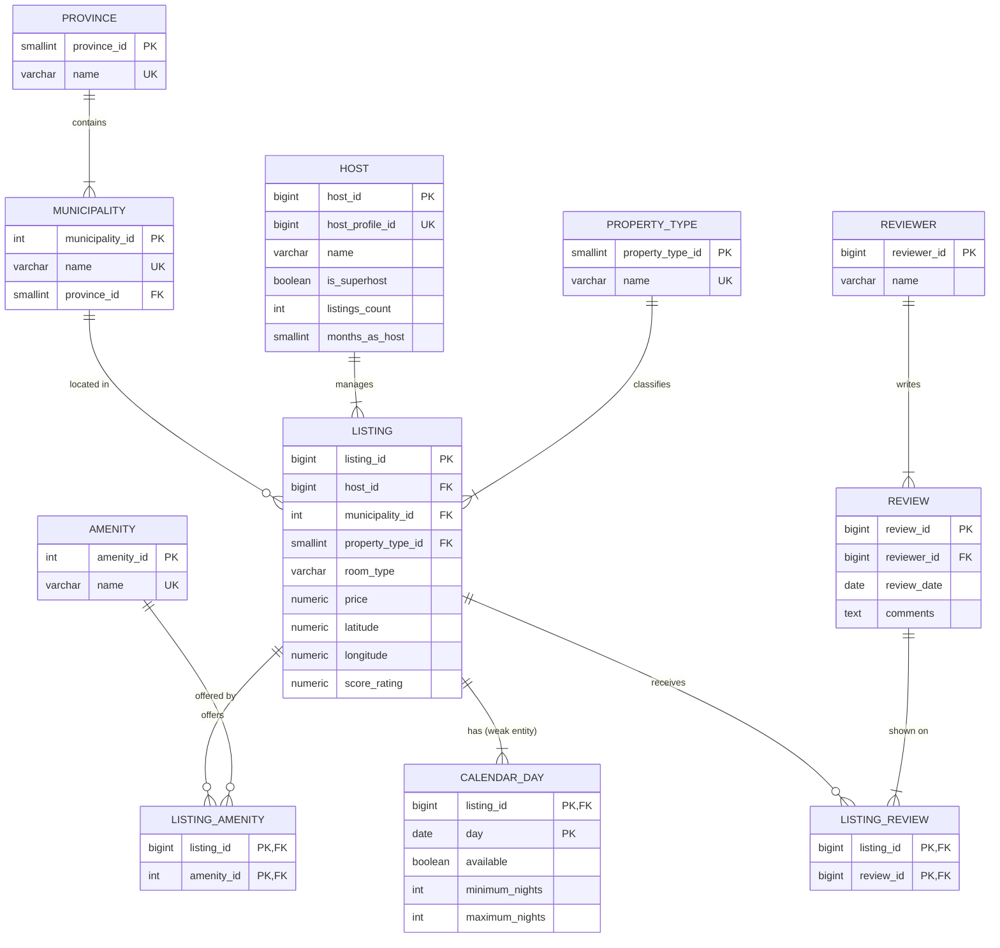

# Modelo conceptual, lógico y físico

> El enunciado pide el diagrama ER **en la notación del curso**. El diagrama de abajo
> (Mermaid, se ve directamente en GitHub) sirve de borrador: hay que redibujarlo en la
> notación de clase (p. ej. con draw.io) para el informe.

## 1. Diagrama entidad-relación (borrador)

**Cardinalidades en palabras**

| Relación | Cardinalidad | Por qué |
|---|---|---|
| Province – Municipality | 1 : N | cada municipio pertenece a una sola provincia (comprobado: 0 municipios en dos provincias) |
| Municipality – Listing | 1 : N (0..N) | 48 municipios no tienen ningún anuncio |
| Host – Listing | 1 : N (1..N) | un anfitrión tiene al menos un anuncio (3.094 hosts, 6.248 anuncios) |
| Property type – Listing | 1 : N | 64 tipos |
| Listing – Amenity | N : M | un anuncio ofrece muchos servicios y un servicio aparece en muchos anuncios |
| Listing – Calendar day | 1 : N, entidad débil | un día de calendario no existe sin su anuncio; su clave es (anuncio, fecha) |
| Listing – Review | **N : M** | ver excepción 1 |
| Reviewer – Review | 1 : N | un huésped escribe muchas reseñas |

## 2. Modelo relacional

Notación: <u>subrayado</u> = clave primaria, *cursiva* = clave foránea.

- PROVINCE(<u>province_id</u>, name)
- MUNICIPALITY(<u>municipality_id</u>, name, *province_id*)
- HOST(<u>host_id</u>, host_profile_id, name, location, about, is_superhost, has_profile_pic, identity_verified, listings_count, months_as_host, months_as_user)
- PROPERTY_TYPE(<u>property_type_id</u>, name)
- LISTING(<u>listing_id</u>, *host_id*, *municipality_id*, *property_type_id*, name, description, latitude, longitude, room_type, accommodates, bathrooms, bathroom_shared, bathrooms_text, bedrooms, beds, price, minimum_nights, maximum_nights, has_availability, score_rating, score_accuracy, score_cleanliness, score_checkin, score_communication, score_location, score_value, license, estimated_occupancy_l365d, estimated_revenue_l365d, source, last_scraped)
- AMENITY(<u>amenity_id</u>, name)
- LISTING_AMENITY(<u>*listing_id*, *amenity_id*</u>)
- CALENDAR_DAY(<u>*listing_id*, day</u>, available, minimum_nights, maximum_nights)
- REVIEWER(<u>reviewer_id</u>, name)
- REVIEW(<u>review_id</u>, *reviewer_id*, review_date, comments)
- LISTING_REVIEW(<u>*listing_id*, *review_id*</u>)

Todas las tablas están en **3FN**: cada atributo depende de la clave entera y solo de la clave.

## 3. Decisiones y excepciones justificadas

1. **Las reseñas son N:M con los anuncios (no 1:N).**
   En `reviews.csv` hay 8.074 `id` de reseña repetidos (21.436 filas). Todas las copias tienen la
   misma fecha, el mismo autor y el mismo texto, solo cambia el anuncio, y siempre son anuncios
   **del mismo anfitrión**. Airbnb muestra una misma reseña en varios anuncios agrupados del mismo
   anfitrión. Si usáramos `review_id` como PK de una tabla 1:N, la carga fallaría. Si usáramos
   (listing_id, review_id) como PK, el texto se repetiría 13.362 veces. Solución: REVIEW guarda cada
   reseña una vez y LISTING_REVIEW guarda la relación.
   Consecuencia: para contar reseñas de una zona hay que usar `COUNT(DISTINCT review_id)` (ver Q03).

2. **No se guardan columnas derivables.** `number_of_reviews`, `first_review`, `last_review` y
   `reviews_per_month` se pueden calcular desde LISTING_REVIEW/REVIEW. El perfilado comprobó que
   coinciden en el 100 % de los anuncios. `calculated_host_listings_count*` se calcula con
   un `COUNT` por host. `availability_30/60/90/365` y `minimum_minimum_nights` etc. salen de
   CALENDAR_DAY. Guardarlas sería redundancia: dos fuentes de verdad que pueden contradecirse.
   Excepción: `host.listings_count` **sí** se guarda porque cuenta los anuncios del anfitrión en
   todo el mundo, no solo en Euskadi, y no se puede calcular con nuestros datos.
   `estimated_occupancy_l365d` / `estimated_revenue_l365d` son estimaciones del modelo de
   Inside Airbnb sobre datos que no tenemos, así que también se guardan.

3. **Columnas descartadas:** las 12 columnas 100 % vacías (`host_since`, `host_response_rate`,
   `bathrooms`, `instant_bookable`…), las URL (se reconstruyen con el id), los metadatos
   constantes del scrape (`scrape_id`, `calendar_last_scraped`), `host_verifications`
   (siempre "None") y los campos `price_quote_*` (una cotización puntual que duplica el precio).

4. **`room_type` es un CHECK y `property_type` una tabla.** `room_type` tiene 4 valores fijos
   definidos por Airbnb, así que basta con un CHECK. `property_type` tiene 64 valores abiertos,
   así que va en una tabla de referencia.

5. **Amenities en tabla aparte.** En el CSV vienen como una lista JSON dentro de una celda, lo
   que incumple la 1FN. Al separarlas se puede preguntar en SQL "¿qué anuncios tienen X?" (Q06).

6. **El precio está en euros** aunque el CSV use el símbolo `$`, que es el formato fijo de
   Inside Airbnb. Se guarda como `NUMERIC(10,2)` (dinero exacto, sin errores de coma flotante).

7. **Claves sustitutas (IDENTITY)** para province, municipality, property_type y amenity:
   sus claves naturales son textos largos. Los ids de Airbnb (`listing_id`, `host_id`,
   `review_id`, `reviewer_id`) se mantienen como **claves naturales** `BIGINT`, porque llegan
   a 1,7·10¹⁸ y no caben en `INTEGER`.

8. **`minimum_nights > maximum_nights`** (2 anuncios y 763 días de calendario): es imposible.
   Como no sabemos cuál de los dos valores está mal, ambos se dejan en NULL. No se inventa
   ninguno, y así el `CHECK (minimum_nights <= maximum_nights)` puede existir.

## 4. Tipos de datos elegidos

| Dato | Tipo | Motivo |
|---|---|---|
| ids de Airbnb | `BIGINT` | valores de hasta 19 dígitos |
| precio, ingresos | `NUMERIC(10,2)` | dinero exacto |
| puntuaciones | `NUMERIC(3,2)` + CHECK 0–5 | p. ej. 4.87 |
| latitud / longitud | `NUMERIC(8,6)` / `NUMERIC(9,6)` | 6 decimales ≈ 0,1 m; CHECK con la caja de Euskadi |
| baños | `NUMERIC(3,1)` | permite medios baños (1.5) |
| plazas, camas, dormitorios | `SMALLINT` | valores pequeños (máx. 29) |
| fechas | `DATE` | sin hora en los datos |
| t/f | `BOOLEAN` | |
| textos cortos | `VARCHAR(n)` con n ≥ máximo observado en el perfilado | |
| descripciones, reseñas | `TEXT` | longitud libre |
